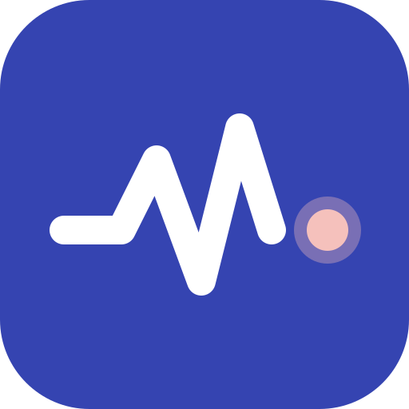
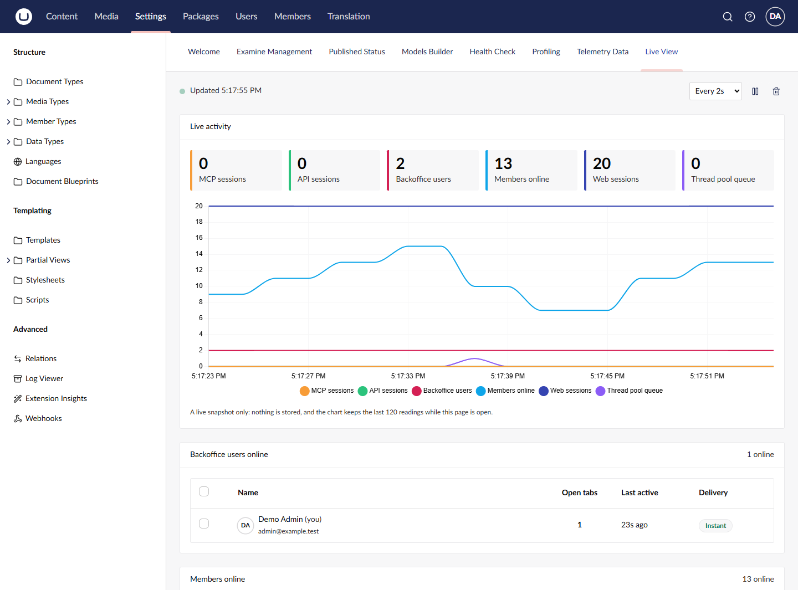
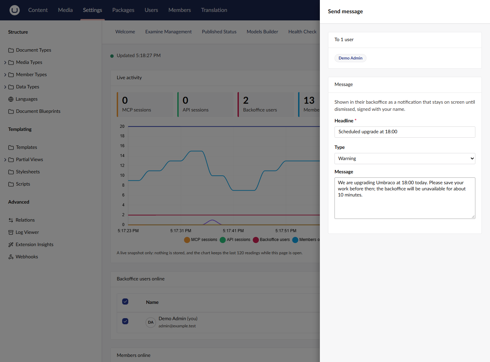
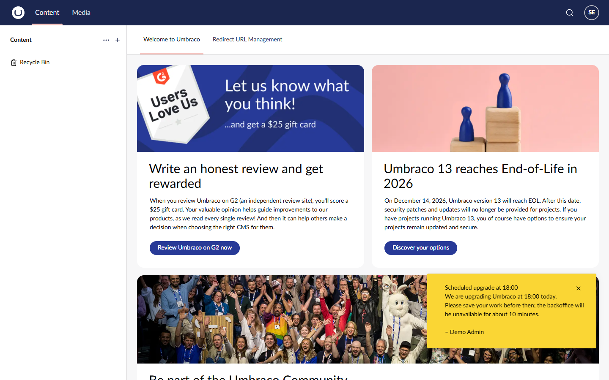

# Umbricians Live View

[](https://www.nuget.org/packages/Umbricians.LiveView)
[](https://github.com/Umbricians/Live-View/actions/workflows/build.yml)

A real-time **Live View** dashboard for the Umbraco **Settings** section (Umbraco 17.8+). It charts how many
sessions are active right now:

- **Web sessions**: front-end visitors
- **Backoffice users**: editors with the backoffice open
- **Members online**: website visitors logged in as Umbraco members
- **MCP sessions**: clients using an MCP endpoint hosted by the site
- **API sessions**: callers of the Delivery API or your own `/api` endpoints
- **Anything else** you plug in

The chart refreshes every 2, 5, 10, 15 or 30 seconds (your choice is remembered per browser). Nothing is stored:
the server keeps an in-memory set of recently active sessions, and the browser keeps the last 120 readings while
the page is open.



Below the chart, two tables list who is online right now. Both are paged on the server (25 per page), so only the
page being viewed is ever looked up, however many people are online. Rows are ordered by when each person came
online, newest first, so they stay put between refreshes.

**Members online** lists logged-in members with their member type and when they were last active. A member drops
off as soon as they log out, or once their activity window passes. If the site has
[member message senders](#4-messaging-members), members can be selected and messaged too: tick some, or click
**Select all N online**, then **Message members…**. The slide-out sends to the selected members, everyone online, or
every member of the site, using whichever of the site's delivery methods you tick.

**Backoffice users online** lists who has the backoffice open. Tick one or several of them (the selection is kept
across pages), or click **Select all N online** to include every page, then click **Message users…** in the footer to open a slide-out where you write a headline, pick a type
(information, warning, urgent or good news) and add a message, for example to warn people before an upgrade or
restart. It appears in their backoffice as a standard Umbraco notification that stays until dismissed, and is
signed with the sender's name.



The message arrives instantly in the recipient's backoffice, wherever they are:



- Every backoffice sends a small heartbeat once a minute, so idle editors are listed too.
- **Open tabs** shows how many backoffice tabs or windows each user has open. It comes from Umbraco's realtime
  (server events) connections, one per tab, so it drops as soon as a tab closes. If a user's realtime connection
  is down, the count falls back to heartbeats, and a closed tab then drops off within about two and a half minutes.
- Messages are pushed over Umbraco's server events (SignalR), so they arrive instantly. If a user's realtime
  connection is down, their next heartbeat picks the message up instead ("Delivery" column).
- Messages are held in memory for 15 minutes, then discarded.

## Installation

```bash
dotnet add package Umbricians.LiveView
```

Restart the site and open **Settings → Live View**. The dashboard is available to backoffice users with access to
the Settings section; no configuration is needed to get started.

## How sessions are counted

Middleware offers each request to the channels in order and counts it in every channel whose path prefixes it falls
under, stopping at the first *exclusive* one (channels are exclusive unless `Exclusive` is `false`). For each, it
works out a session key and keeps the session active for the length of the request and for the channel's
*activity window* after it. Session keys are hashed before they are held in memory, and no cookies are set.

| Channel | Paths | Session key (first one present) | Window |
|---|---|---|---|
| `mcp` | `/mcp`, `/umbraco/mcp` | `Mcp-Session-Id` header → `Authorization` → client IP + User-Agent | 300s |
| `api` | `/api`, `/umbraco/delivery/api` | `Api-Key` header → `Authorization` → client IP + User-Agent | 60s |
| `backoffice` | `/umbraco` (static files excluded) | the signed-in backoffice user | 300s |
| `members` | the same paths as `web`; not exclusive, so members are counted in `web` too | the logged-in member | 300s |
| `web` | everything else, except `/umbraco`, `/App_Plugins`, `/media` and static files | client IP + User-Agent | 300s |

Because the session stays active for as long as a request is open, long-lived MCP streams (SSE) count while they
are connected. Crawlers are ignored by default.

Backoffice users and members are counted once per person, however many tabs or devices they use. Only requests that
pass authentication count, so a failed login or a forged token never shows up.

Web sessions are counted per visitor, not per tab: several tabs in the same browser share the IP address and
User-Agent that identify the visitor, so they count once. Different browsers or devices count separately, while
visitors behind one shared IP address using an identical browser version are counted as one.

> Counts are per server. On a load-balanced site, each server sees only its own traffic.

## Configuration

Everything is optional. Override only what you need in `appsettings.json`:

```json
{
  "Umbricians": {
    "LiveView": {
      "TrackingEnabled": true,
      "ActivityWindowSeconds": 300,
      "IgnoreBots": true,
      "MaxSessionsPerChannel": 100000,
      "Channels": {
        "mcp": { "PathPrefixes": [ "/my-mcp" ] },
        "api": { "Enabled": false },
        "headless": {
          "Name": "Headless app",
          "Color": "#d42054",
          "SortOrder": 30,
          "PathPrefixes": [ "/graphql" ],
          "SessionKeys": [ "Header:X-Client-Id", "Client" ]
        }
      }
    }
  }
}
```

Built-in channels keep their defaults for any property you leave out. Session key sources are `Header:<name>`,
`Cookie:<name>`, `Authorization`, `User` (the authenticated backoffice user or member) and `Client`. Set
`"Exclusive": false` on a channel whose requests should also count in later channels, as the built-in `members`
channel does.

## Extending

There are three ways to put your own data on the chart, from least to most code.

### 1. A path-based channel (no code)

Add a channel under `Umbricians:LiveView:Channels` as shown above.

### 2. Feed a channel from code

When your code knows exactly when a session starts and ends (an in-process MCP server, a SignalR hub, a
WebSocket), declare a channel and drive it through `ILiveActivityTracker`:

```csharp
public class LiveViewComposer : IComposer
{
    public void Compose(IUmbracoBuilder builder) =>
        builder.AddLiveViewChannel("signalr", "SignalR clients", c => c.Color = "#0ea5e9");
}

public class ChatHub(ILiveActivityTracker tracker) : Hub
{
    public override Task OnConnectedAsync()
    {
        tracker.Touch("signalr", Context.ConnectionId);
        return base.OnConnectedAsync();
    }

    public override Task OnDisconnectedAsync(Exception? exception)
    {
        tracker.End("signalr", Context.ConnectionId);
        return base.OnDisconnectedAsync(exception);
    }
}
```

`BeginActivity(channel, key)` returns an `IDisposable` that keeps the session active until it is disposed.

### 3. A custom metric provider

For any number the site can work out on demand, such as a count reported by an out-of-process MCP server,
implement `ILiveMetricProvider`:

```csharp
public class McpServerSessionsMetric(IHttpClientFactory http) : ILiveMetricProvider
{
    public string Alias => "mcp-server";
    public string Name => "MCP server sessions";
    public string? Color => "#f79c37";

    public async Task<double> GetValueAsync(CancellationToken cancellationToken)
    {
        var status = await http.CreateClient().GetFromJsonAsync<Status>("http://mcp-host/status", cancellationToken);
        return status!.ActiveSessions;
    }

    private record Status(int ActiveSessions);
}

// in a composer
builder.AddLiveViewMetric<McpServerSessionsMetric>();
```

Providers are called on every poll and given 2 seconds to answer. A slow or failing provider shows as a gap in its
line rather than breaking the dashboard. See
[ThreadPoolQueueMetric.cs](demo/Umbricians.LiveView.Demo/LiveView/ThreadPoolQueueMetric.cs) for a working example.

### 4. Messaging members

How a message reaches website members is up to each site: SignalR, a banner on their next page view, email, push
notifications. The dashboard collects the message and works out who it is for; you plug in the delivery by
implementing `IMemberMessageSender`. Member messaging appears on the dashboard once at least one sender is
registered, and the person sending picks which senders to use.

```csharp
public class EmailMemberMessageSender(IEmailSender email, IMemberService members) : IMemberMessageSender
{
    public string Alias => "email";
    public string Name => "Email";
    public string? Description => "Sends the message to each member's email address.";
    public bool ReachesOfflineMembers => true;

    public async Task<MemberMessageResult> SendAsync(MemberMessage message, CancellationToken cancellationToken)
    {
        // message.MemberKeys lists the recipients, except for MemberMessageAudience.AllMembers,
        // where it is empty and the sender reaches every member in its own way.
        ...
        return new MemberMessageResult(sent, "emailed");
    }
}

// in a composer
builder.AddMemberMessageSender<EmailMemberMessageSender>();
```

A `MemberMessage` has a headline, a plain-text body (encode it wherever you display it), a type (information,
warning, urgent or good news), the audience, the sender's name and an expiry chosen on the dashboard. Each sender
gets 30 seconds; its result, or failure, is reported back on the dashboard.

For banner-style delivery, the package includes `IMemberMessageInbox`: a sender adds the message to it, and your
own view component or endpoint reads `GetUnread(memberKey)` and calls `MarkRead` when a member dismisses it. Messages
stay until they expire; nothing is persisted.

The demo site has two working examples in
[MemberMessageSenders.cs](demo/Umbricians.LiveView.Demo/DemoMembers/MemberMessageSenders.cs): a SignalR pop-up on
pages members have open, and a banner shown on their next page view.

## API

All under `/umbraco/umbriciansliveview/api/v1/`.

| Endpoint | Who can call it |
|---|---|
| `GET snapshot`, `GET backoffice-users`, `GET members`, `POST messages`, `GET member-messaging`, `POST member-messages` | backoffice users with access to the Settings section |
| `GET heartbeat`, `GET messages/{key}` | any backoffice user (recipients only for a message) |

`GET snapshot` returns:

```json
{
  "timestamp": "2026-10-29T18:54:24Z",
  "metrics": [
    { "alias": "mcp", "name": "MCP sessions", "color": "#f79c37", "value": 3, "error": null }
  ]
}
```

## Licence

[MIT](LICENSE). Copyright (c) 2026 FYIN LLC (trading as Umbricians).

## Development

```
src/Umbricians.LiveView          the package (Razor class library + Client/ TypeScript)
demo/Umbricians.LiveView.Demo    Umbraco 17.8 site on SQLite that references the package
```

```bash
cd src/Umbricians.LiveView/Client && npm install && npm run build
```

```bash
dotnet run --project demo/Umbricians.LiveView.Demo
```

Run `npm run watch` in `Client/` while working on the dashboard. The demo's test admin login is in
`demo/Umbricians.LiveView.Demo/appsettings.Development.json`.

### Testing members (demo only)

The demo, not the package, creates 30 test members on startup (`member01@example.test` to
`member30@example.test`, settings under `LiveViewDemo:Members`) and has a bare login page at
**`/demo/members`** for logging in and out as any of them. Each browser or private window holds one member session,
so use several to have more than one member online.

> The demo reads `appsettings.{environment}.json`. If your machine sets `DOTNET_ENVIRONMENT` (for example to
> `Local`), that overrides the launch profile's `Development`, so the demo settings also live in
> `appsettings.Local.json`.

To package, build the client first, then:

```bash
dotnet pack src/Umbricians.LiveView -c Release
```

Packing stops with an error if the dashboard bundle has not been built.

Release steps for maintainers are in [docs/RELEASING.md](docs/RELEASING.md).
