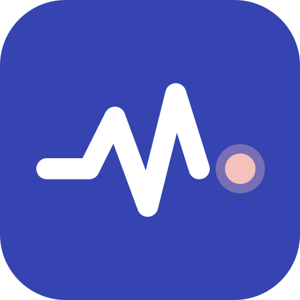
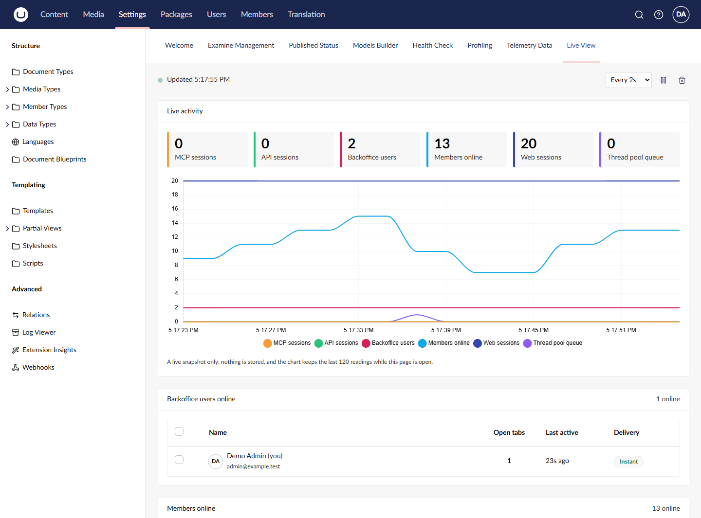
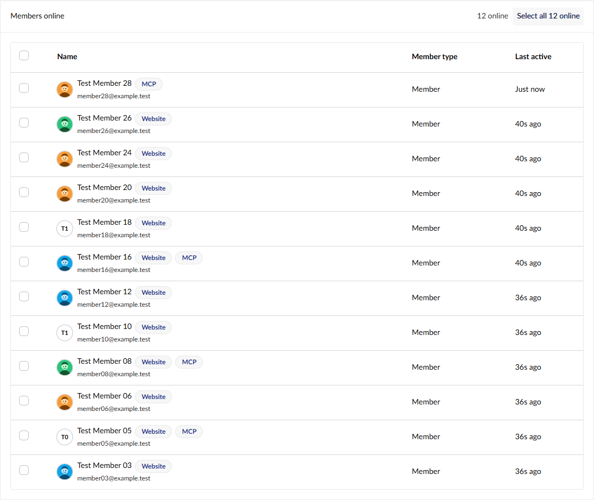
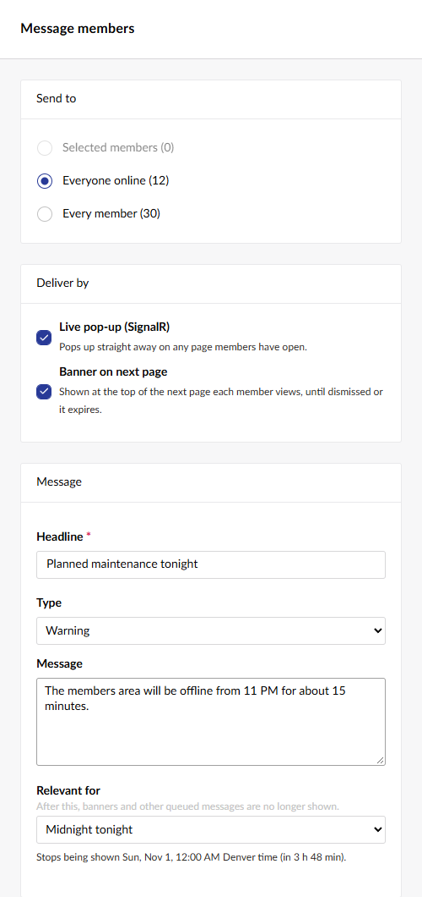
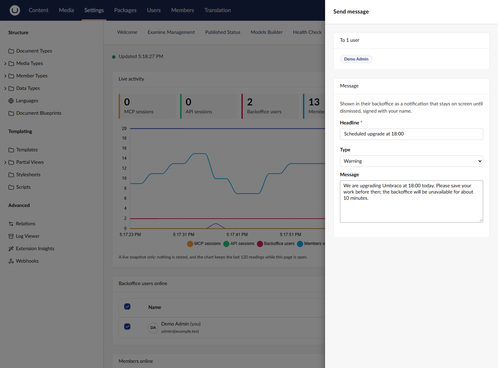
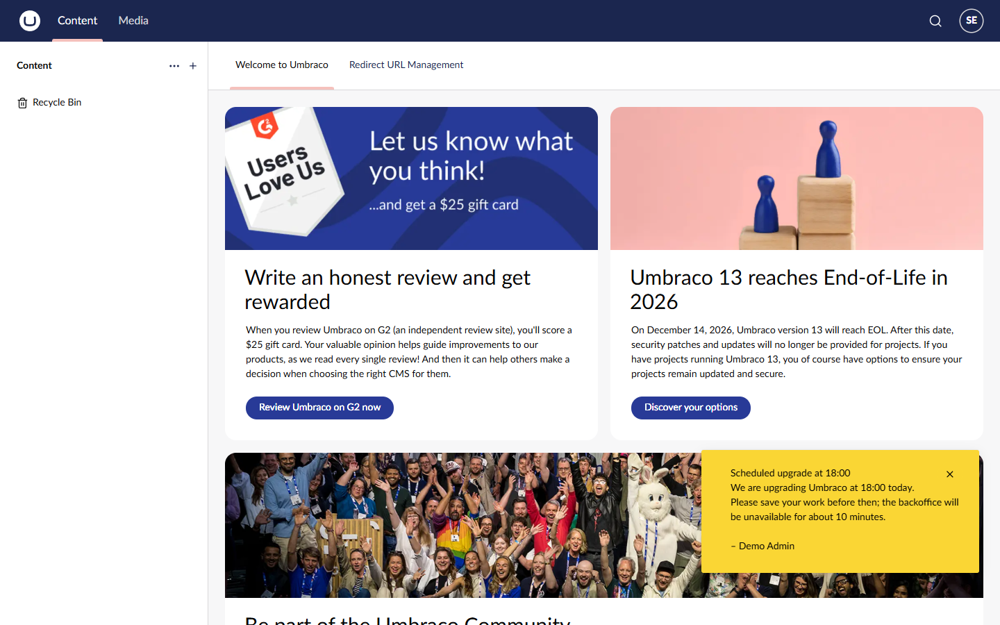

# Umbricians Live View

[](https://www.nuget.org/packages/Umbricians.LiveView)
[](https://github.com/Umbricians/Live-View/actions/workflows/build.yml)

A real-time **Live View** dashboard for the Umbraco **Settings** section (Umbraco 17.8+). It charts how many
sessions are active right now:

- **Web sessions**: front-end visitors
- **Backoffice users**: editors with the backoffice open
- **Members online**: website visitors logged in as Umbraco members
- **MCP sessions**: clients using an MCP endpoint hosted by the site
- **API sessions**: callers of the Delivery API or your own `/api` endpoints
- **Anything else** you plug in

The chart refreshes every 2, 5, 10, 15 or 30 seconds by default (your choice is remembered per browser). Nothing is
stored: the server keeps an in-memory set of recently active sessions (by default; see
[load-balanced sites](#8-load-balanced-sites)), and the browser keeps the last 120 readings while the page is open.
The refresh choices and the number of readings can be [configured](#configuration).

Click a counter, or its legend entry, to take its line off the chart; both fade until you click either again.



Below the chart, two tables list who is online right now, one row per person. Both are paged on the server (25 per
page), so only the page being viewed is ever looked up, however many people are online. Rows are ordered by when each
person came online, newest first, so they stay put between refreshes.

**Members online** lists logged-in members with their picture, member type and when they were last active. The
picture comes from the site's [member avatar provider](#5-member-avatars); members without one show their initials. A
member drops off as soon as they log out, or once their activity window passes.

Members using an [MCP](#mcp-callers) endpoint are listed too. While anyone in the table is on MCP, every row is tagged
with how that member is online: **Website**, **MCP** or both. Hover over a tag to see when they were last seen that
way. While nobody is on MCP, there are no tags.



If the site has [member message senders](#4-messaging-members), members can be selected and messaged too: tick some,
or click **Select all N online**, then **Message members…**. The slide-out sends to the selected members, everyone
online, or every member of the site, using whichever of the site's delivery methods you tick.

**Relevant for** sets when the message stops being shown: **15 minutes**, **1 hour**, **Midnight tonight**,
**24 hours**, **7 days**, or **Custom…**, which takes hours and minutes, from 1 minute up to 30 days. The line below
it shows the exact time in your language and culture, for example "Stops being shown Sun, Nov 1, 12:00 AM Denver
time (in 3 h 48 min)". Midnight is in the [`MessageTimeZone`](#configuration) if the site sets one, otherwise in your
own browser's time zone.



**Backoffice users online** lists who has the backoffice open, with the avatar each user set in Umbraco, or their
initials. Users on MCP are tagged the same way, **Backoffice**, **MCP** or both. A user only on MCP shows "–" for open
tabs and can't be selected, since a backoffice message is shown in a backoffice tab. Tick one or several of the others (the selection is kept
across pages), or click **Select all N online** to include every page, then click **Message users…** in the footer to open a slide-out where you write a headline, pick a type
(information, warning, urgent or good news) and add a message, for example to warn people before an upgrade or
restart. The slide-out sends to the selected users, to everyone online, or to everyone online in the user groups you
pick with Umbraco's user group picker (for example Editors before an upgrade), and shows how many users that reaches
right now. Choosing user groups needs access to the Users section. It appears in their backoffice as a standard Umbraco notification that stays until dismissed, and is
signed with the sender's name. You are marked **You** in the list and are never sent your own message.



The message arrives instantly in the recipient's backoffice, wherever they are:



- Every backoffice tab sends a small heartbeat once a minute, so idle editors are listed and counted too. A user
  is online while they have a tab open, or for the backoffice channel's activity window after their last request.
  The **Backoffice users** line on the chart counts the same users the table lists.
- **Open tabs** shows how many backoffice tabs or windows each user has open. It comes from Umbraco's realtime
  (server events) connections, one per tab, so it drops as soon as a tab closes. If a user's realtime connection
  is down, the count falls back to heartbeats, and a closed tab then drops off within about two and a half minutes.
- Messages are pushed over Umbraco's server events (SignalR), so they arrive instantly. If a user's realtime
  connection is down, their next heartbeat picks the message up instead ("Delivery" column).
- Messages are held for 15 minutes (`BackofficeMessageLifetimeMinutes`) in the message store (in memory by default), then discarded.
- Every message sent is recorded in [Umbraco's audit log](#7-before-and-after-a-message-is-sent): who sent it, to whom and its headline.

## Documentation

- **[Getting started](docs/getting-started.md)**: install, find the dashboard, configure what is counted, add your
  own lines, what to check before going live and the health checks to run.
- **[Messaging members](docs/member-messaging.md)**: let the dashboard message your website's members, with complete
  banner, SignalR pop-up and email examples.

## Installation

```bash
dotnet add package Umbricians.LiveView
```

Restart the site and open **Settings → Live View**. No configuration is needed to get started.

## Permissions

Live View adds three permissions to Umbraco's user groups, under **Users → User groups → (a group) → Live View**:

| Permission | What it allows |
|---|---|
| **View Live View** | See the Live View dashboard in Settings: live activity and who is online. |
| **Message backoffice users** | Select backoffice users, or pick user groups (which also needs access to the Users section), and send them a notification. |
| **Message members** | Select website members and send them a message, once a developer has [set up a delivery method](docs/member-messaging.md). |

The **Administrators** group gets all three automatically when the package is installed or upgraded; other groups
get none until you switch them on. The dashboard is in the Settings section, so a group also needs access to Settings to open it there. The API checks
only these permissions, so a site can
[show the dashboard in another section](docs/getting-started.md#showing-the-dashboard-in-another-section) with a
manifest alone. Every backoffice user can receive messages. See [Permissions](docs/getting-started.md#permissions) for details.

## How sessions are counted

Middleware offers each request to the channels in order and counts it in every channel it matches, stopping at the
first *exclusive* one (channels are exclusive unless `Exclusive` is `false`). A request matches a channel when it
falls under one of the channel's path prefixes (when it has any) and none of its excluded ones, is for one of its
`Hosts` (when it lists any), and passes its request predicate (when it has one). For each channel, it works out a session key from the channel's
session key sources and keeps the session active for the length of the request and for the channel's
*activity window* after it. Session keys are hashed before they are held in memory, and no cookies are set.

| Channel | Paths | Session key (first one present) | Window |
|---|---|---|---|
| `mcp` | `/mcp`, `/umbraco/mcp` | `Mcp-Session-Id` header → `Authorization` → client IP + User-Agent | 300s |
| `api` | `/api`, `/umbraco/delivery/api` | `Api-Key` header → `Authorization` → client IP + User-Agent | 60s |
| `backoffice` | `/umbraco` (static files excluded) | the signed-in backoffice user | 300s |
| `members` | the same paths as `web`; not exclusive, so members are counted in `web` too | the logged-in member | 300s |
| `web` | everything else, except `/umbraco`, `/App_Plugins`, `/media` and static files | client IP + User-Agent | 300s |

Because the session stays active for as long as a request is open, long-lived MCP streams (SSE) count while they
are connected. Crawlers are ignored by default; add your own uptime monitors and the like with `BotUserAgents`.

A site with several domains can count each on its own line with `Hosts`, and sessions can be keyed on anything the
site's code works out, such as a tenant or API client id: see [Extending](#1-a-channel-for-requests).

Backoffice users and members are counted once per person, however many tabs or devices they use, and whether they
are in the backoffice or on the website, on MCP, or both. Only requests that pass authentication count, so a failed
login or a forged token never shows up.

### MCP callers

When a backoffice user or member signs in to an MCP endpoint the site hosts (under the `mcp` channel's paths), they
are listed in the matching online table, still one row each. While anyone in a table is on MCP, every row in it is
tagged with how that person is online (**Backoffice** or **Website**, **MCP**, or both), and hovering a tag shows when
they were last seen that way; while nobody is, the tags are left out. Their key is looked up as a backoffice user
first, then as a member; the answer is remembered for five minutes. They are shown as soon as the response starts, so
a long-lived stream lists its caller, as active, while it is connected, and they stay listed for the `mcp` channel's
activity window after their last request. Backoffice users only on MCP can't be messaged, since a backoffice message
is shown in a backoffice tab.

An MCP server that runs elsewhere, such as one calling the Management API as an API user, only knows its callers
itself. Report them with `ILiveViewPresence`:

```csharp
public class McpToolHandler(ILiveViewPresence presence)
{
    public async Task HandleAsync(Guid callerKey, CancellationToken cancellationToken)
    {
        await presence.McpCallerSeenAsync(callerKey, cancellationToken); // a backoffice user's or member's key
        // ...
    }
}
```

Web sessions are counted per visitor, not per tab: several tabs in the same browser share the IP address and
User-Agent that identify the visitor, so they count once. Different browsers or devices count separately, while
visitors behind one shared IP address using an identical browser version are counted as one.

> By default counts are per server: on a load-balanced site, each server sees only its own traffic. See
> [Load-balanced sites](docs/getting-started.md#load-balanced-sites) to share them.

## Health checks

Live View adds a **Live View** group to **Settings → Health Check** that looks for common misconfigurations. Each check
can be turned off through Umbraco's `Umbraco:CMS:HealthChecks:DisabledChecks`.

- **Visitor IP addresses behind a proxy**: requests from a proxy whose forwarded headers aren't applied.
- **Request counting**: `TrackingEnabled` turned off.
- **Member messaging**: a group may message members, but no member message sender is registered.
- **Member avatar property**: `MemberAvatarProperty` names a property no member type has.
- **Channel paths**: a channel whose paths an earlier exclusive channel counts first.

See [Before you go live](docs/getting-started.md#before-you-go-live).

## Languages

The dashboard, dialogs and permissions follow each backoffice user's language, and show dates, times and numbers
in their culture. Live View ships English, and a term a language does not have falls back to English.

To add a language or reword one, add an `App_Plugins/MySite/umbraco-package.json` with a `localization` extension:

```json
{
  "name": "MySite Live View Danish",
  "extensions": [
    {
      "type": "localization",
      "alias": "MySite.Localization.LiveView.Da",
      "name": "MySite Live View Danish",
      "meta": { "culture": "da" },
      "js": "/App_Plugins/MySite/live-view.da.js"
    }
  ]
}
```

The JavaScript module lists the terms, under `umbriciansLiveView`:

```js
export default {
  umbriciansLiveView: {
    refreshInterval: "Opdateringsinterval",
    onlineCount: (count) => `${count} online`,
  },
};
```

Terms with a count are functions of it; plain wording can instead go in `meta.localizations` in the JSON. To
reword English, use `culture: "en"` and a `weight` below 100. [The English terms](src/Umbricians.LiveView/Client/src/localization/en.ts)
are the full list.

## Configuration

Everything is optional. Override only what you need in `appsettings.json`:

```json
{
  "Umbricians": {
    "LiveView": {
      "TrackingEnabled": true,
      "ActivityWindowSeconds": 300,
      "IgnoreBots": true,
      "MaxSessionsPerChannel": 100000,
      "MemberAvatarProperty": "avatar",
      "MessageTimeZone": "America/Denver",
      "BackofficeMessageLifetimeMinutes": 15,
      "BotUserAgents": [ "StatusCake" ],
      "Dashboard": {
        "RefreshIntervals": [ 2, 5, 10, 15, 30 ],
        "DefaultRefreshInterval": 5,
        "MaxReadings": 120
      },
      "Channels": {
        "mcp": { "PathPrefixes": [ "/my-mcp" ] },
        "api": { "Enabled": false },
        "headless": {
          "Name": "Headless app",
          "Color": "#d42054",
          "SortOrder": 30,
          "PathPrefixes": [ "/graphql" ],
          "SessionKeys": [ "Header:X-Client-Id", "Client" ]
        }
      }
    }
  }
}
```

Built-in channels keep their defaults for any property you leave out. Session key sources are `Header:<name>`,
`Cookie:<name>`, `Authorization`, `User` (the authenticated backoffice user or member) and `Client`, or the alias of a
[session key source of your own](#your-own-session-key-sources). `Hosts` limits a channel to requests for those host
names, ignoring port: `brand-a.com`, or `*.brand-a.com` for its subdomains. With `Hosts` and no `PathPrefixes`, a
channel counts every path on those hosts. When `Hosts` is empty, any host matches. Set
`"Exclusive": false` on a channel whose requests should also count in later channels. The built-in `members`
channel always counts the signed-in member and always lets members count as web visitors too, so `SessionKeys` and
`Exclusive` don't apply to it; its other settings do. The built-in `backoffice` channel always counts the signed-in
backoffice user, so `SessionKeys` doesn't apply to it.

The same settings restyle a line from a [custom metric provider](#3-a-custom-metric-provider), under the provider's
`Alias`: `Name`, `Color` and `SortOrder` replace the provider's own values, and `"Enabled": false` takes the line off the
chart and stops the provider being called. Anything left out keeps the provider's own value. `PathPrefixes`, `Hosts`,
`ExcludePathPrefixes`, `SessionKeys`, `RequestPredicate`, `ActivityWindowSeconds`, `IgnoreStaticFiles` and `Exclusive` don't apply to a
provider and are ignored.

```json
{ "Umbricians": { "LiveView": { "Channels": { "mcp-server": { "Name": "Remote MCP", "SortOrder": 15 } } } } }
```

`MemberAvatarProperty` names the member property that holds each member's picture; see
[member avatars](#5-member-avatars).

`MessageTimeZone` is the time zone a member message sent until "midnight tonight" expires in, as an IANA id such as
`America/Denver` (a Windows id works too). Without it, midnight is the sending backoffice user's own.

`BackofficeMessageLifetimeMinutes` (default 15) is how long a backoffice message waits for recipients whose realtime
connection is down.

`BotUserAgents` (default none) is text matched anywhere in the User-Agent, ignoring case, on top of the built-in
crawler patterns, while `IgnoreBots` is on. Surrounding spaces and blank entries are ignored.

`Dashboard` sets what the dashboard offers: `RefreshIntervals` in seconds, offered shortest first, each once (default 2, 5, 10, 15 and 30),
`DefaultRefreshInterval` (default 5, or the shortest choice when 5 isn't offered; a browser whose remembered choice is
no longer offered goes back to it) and `MaxReadings`, how many readings the chart keeps (default 120). If the dashboard can't read these settings, it uses the built-in ones and shows a warning.

A value that can't work never stops the site. It is replaced by its default, with a warning in the log naming the
setting:

- a number that isn't positive: `ActivityWindowSeconds`, `MaxSessionsPerChannel`, `BackofficeMessageLifetimeMinutes`,
  `Dashboard:RefreshIntervals` or `Dashboard:MaxReadings`. A channel's `ActivityWindowSeconds` falls back to the
  window `AddLiveViewChannel` gave it, then its built-in window, then the site-wide `ActivityWindowSeconds`;
- a `Dashboard:DefaultRefreshInterval` that isn't one of the `RefreshIntervals`;
- a `MessageTimeZone` the server doesn't know, which is ignored, so midnight is each sender's own.

## Extending

Ways to add your own data and panels to the dashboard, from least to most code.

### 1. A channel for requests

Add a channel under `Umbricians:LiveView:Channels` as shown above. No code needed. To count each of several sites on
its own line, give each channel its `Hosts`:

```json
"brand-a": {
  "Name": "Brand A",
  "SortOrder": 95,
  "Hosts": [ "brand-a.com", "*.brand-a.com" ],
  "ExcludePathPrefixes": [ "/umbraco", "/App_Plugins", "/media", "/api", "/mcp" ],
  "IgnoreStaticFiles": true
}
```

It sorts after `members` (90), so members are still seen, and before `web` (100). Channels are exclusive by default,
so Web sessions then counts the other sites; set `"Exclusive": false` to keep Web sessions as the total.

#### Matching requests in code

Set a `RequestPredicate` on a channel declared with `AddLiveViewChannel` to match requests by anything the request
carries:

```csharp
builder.AddLiveViewChannel("app", "Mobile app", c =>
{
    c.SortOrder = 5;
    c.RequestPredicate = context => context.Request.Headers.ContainsKey("X-App-Version");
    c.SessionKeys = ["Header:X-Device-Id", "Client"];
});
```

A predicate is used together with the channel's path prefixes and hosts, or on its own. It runs before authentication
on every request offered to the channel, so keep it quick; it can't see the signed-in user.

#### Your own session key sources

To key sessions on something only your code knows, implement `ILiveSessionKeySource`, register it with
`builder.AddLiveViewSessionKeySource<T>()` and list its alias in a channel's `SessionKeys`:

```csharp
public class TenantSessionKeySource : ILiveSessionKeySource
{
    public string Alias => "Tenant";

    public bool UsesSignedInUser => true;

    public string? GetSessionKey(HttpContext context) => context.User.FindFirst("tenant_id")?.Value;
}
```

```json
"SessionKeys": [ "Tenant", "Client" ]
```

Sources are tried in order along with the built-in ones; return null to fall through to the next. Values are hashed
before they are held. `UsesSignedInUser` defers reading until authentication has run, as for `User`. The built-in
names always mean the built-in sources.

### 2. Feed a channel from code

When your code knows exactly when a session starts and ends (an in-process MCP server, a SignalR hub, a
WebSocket), declare a channel and drive it through `ILiveActivityTracker`:

```csharp
public class LiveViewComposer : IComposer
{
    public void Compose(IUmbracoBuilder builder) =>
        builder.AddLiveViewChannel("signalr", "SignalR clients", c => c.Color = "#0ea5e9");
}

public class ChatHub(ILiveActivityTracker tracker) : Hub
{
    public override async Task OnConnectedAsync()
    {
        await tracker.TouchAsync("signalr", Context.ConnectionId);
        await base.OnConnectedAsync();
    }

    public override async Task OnDisconnectedAsync(Exception? exception)
    {
        await tracker.EndAsync("signalr", Context.ConnectionId);
        await base.OnDisconnectedAsync(exception);
    }
}
```

`BeginActivityAsync(channel, key)` returns an `IAsyncDisposable` that keeps the session active until it is disposed.

`AddLiveViewChannel` with a built-in alias, such as `members`, restyles that channel. For each property, a value in
`appsettings.json` wins, then a value set with `AddLiveViewChannel`, then the built-in default, whatever order
composers run in.

### 3. A custom metric provider

For any number the site can work out on demand, such as a count reported by an out-of-process MCP server,
implement `ILiveMetricProvider`:

```csharp
public class McpServerSessionsMetric(IHttpClientFactory http) : ILiveMetricProvider
{
    public string Alias => "mcp-server";
    public string Name => "MCP server sessions";
    public string? Color => "#f79c37";

    public async Task<double> GetValueAsync(CancellationToken cancellationToken)
    {
        var status = await http.CreateClient().GetFromJsonAsync<Status>("http://mcp-host/status", cancellationToken);
        return status!.ActiveSessions;
    }

    private record Status(int ActiveSessions);
}

// in a composer
builder.AddLiveViewMetric<McpServerSessionsMetric>();
```

Providers are called on every poll and given 2 seconds to answer. A slow or failing provider shows as a gap in its
line rather than breaking the dashboard. See
[ThreadPoolQueueMetric.cs](demo/Umbricians.LiveView.Demo/LiveView/ThreadPoolQueueMetric.cs) for a working example.

Its line can be renamed, recoloured, reordered or switched off in `appsettings.json` under `Channels:mcp-server`, like
any channel; see [Configuration](#configuration). A provider whose alias matches a channel, built-in or declared in
code, replaces that channel: the channel stops counting requests, and the settings under that alias apply to the
provider's line. Give it an alias no channel uses unless you mean to replace one.

### 4. Messaging members

> The [Messaging members guide](docs/member-messaging.md) walks through this step by step, with complete banner,
> SignalR pop-up and email senders.

How a message reaches website members is up to each site: SignalR, a banner on their next page view, email, push
notifications. The dashboard collects the message and works out who it is for; you plug in the delivery by
implementing `IMemberMessageSender`.

Member messaging is **off by default**: the package ships no senders, so until you register one the members table
has no checkboxes and there is no **Message members…** button. Each sender you register appears as a delivery
option, using its own `Name` and `Description`, and the person sending picks which ones to use.

```csharp
public class EmailMemberMessageSender(IEmailSender email, IMemberService members) : IMemberMessageSender
{
    public string Alias => "email";
    public string Name => "Email";
    public string? Description => "Sends the message to each member's email address.";
    public bool ReachesOfflineMembers => true;

    public async Task<MemberMessageResult> SendAsync(MemberMessage message, CancellationToken cancellationToken)
    {
        // message.MemberKeys lists the recipients, except for MemberMessageAudience.AllMembers,
        // where it is empty and the sender reaches every member in its own way.
        ...
        return new MemberMessageResult(sent, "emailed");
    }
}

// in a composer
builder.AddLiveViewMemberMessageSender<EmailMemberMessageSender>();
```

A `MemberMessage` has a headline, a plain-text body (encode it wherever you display it), a type (information,
warning, urgent or good news), the audience, the sender's name and an expiry chosen on the dashboard: 15 minutes, an hour, midnight tonight
(in the [`MessageTimeZone`](#configuration)), 24 hours, 7 days, or any number of hours and minutes up to 30 days. Each sender
gets 30 seconds; its result, or failure, is reported back on the dashboard.

For banner-style delivery, the package includes `IMemberMessageInbox`: a sender adds the message to it, and your
own view component or endpoint reads `GetUnread(memberKey)` and calls `MarkRead` when a member dismisses it. Messages
stay until they expire; nothing is persisted.

The demo site has two working examples in
[MemberMessageSenders.cs](demo/Umbricians.LiveView.Demo/DemoMembers/MemberMessageSenders.cs): a SignalR pop-up on
pages members have open, and a banner shown on their next page view.

### 5. Member avatars

Backoffice users are shown with the avatar they set in Umbraco. Members have no picture of their own in Umbraco, so
the members table shows their initials unless the site supplies one.

**No code:** add an image property to the member type (a media picker, an image cropper or an upload field) and name
it in `appsettings.json`:

```json
{ "Umbricians": { "LiveView": { "MemberAvatarProperty": "avatar" } } }
```

The picture is cropped to a small square, so the table never loads the full-size image.

**From code:** for any other source, such as Gravatar or an external profile service, implement
`IMemberAvatarProvider`. Yours replaces the built-in one, whichever composer runs first:

```csharp
public class GravatarAvatarProvider : IMemberAvatarProvider
{
    public Task<string?> GetAvatarUrlAsync(IMember member, CancellationToken cancellationToken)
    {
        if (string.IsNullOrEmpty(member.Email))
        {
            return Task.FromResult<string?>(null);
        }

        byte[] hash = SHA256.HashData(Encoding.UTF8.GetBytes(member.Email.Trim().ToLowerInvariant()));
        return Task.FromResult<string?>($"https://gravatar.com/avatar/{Convert.ToHexStringLower(hash)}?s=64&d=404");
    }
}

public class AvatarComposer : IComposer
{
    public void Compose(IUmbracoBuilder builder) =>
        builder.Services.AddSingleton<IMemberAvatarProvider, GravatarAvatarProvider>();
}
```

Return `null` for no picture. The provider is asked for each member on the page being shown, every time the table
refreshes, so keep it quick: it has two seconds, and a member whose provider fails or runs out of time is shown with
their initials. The demo site's
[DemoMemberAvatarProvider.cs](demo/Umbricians.LiveView.Demo/DemoMembers/DemoMemberAvatarProvider.cs) hands out a few
bundled pictures.

### 6. Dashboard panels

Each box on the dashboard is a panel: an `umbriciansLiveViewPanel` extension, shown below the header in weight order,
highest first. The built-in panels are:

| Panel | Alias | Weight |
|---|---|---|
| Live activity | `Umbricians.LiveView.Panel.Activity` | 300 |
| Backoffice users online | `Umbricians.LiveView.Panel.Users` | 200 |
| Members online | `Umbricians.LiveView.Panel.Members` | 100 |

**Adding one:** register it in an `App_Plugins/MySite/umbraco-package.json`, with a weight that puts it where you want
it (150 places it between the two tables):

```json
{
  "id": "MySite",
  "name": "My site",
  "version": "1.0.0",
  "extensions": [
    {
      "type": "umbriciansLiveViewPanel",
      "alias": "MySite.Panel.Orders",
      "name": "My Site Orders Panel",
      "element": "/App_Plugins/MySite/orders-panel.js",
      "weight": 150
    }
  ]
}
```

The element consumes the dashboard context from `@umbricians/live-view`. The context gives a panel two observables,
`interval` (the refresh interval in seconds) and `paused`, so the panel refreshes and pauses with the chart. This one fetches a count from the site's own
endpoint:

```js
import { UmbLitElement } from "@umbraco-cms/backoffice/lit-element";
import { html } from "@umbraco-cms/backoffice/external/lit";
import { UMBRICIANS_LIVE_VIEW_DASHBOARD_CONTEXT } from "@umbricians/live-view";

export default class OrdersPanel extends UmbLitElement {
  static properties = { _count: { state: true } };

  #interval = 5;
  #paused = true;
  #timer;

  constructor() {
    super();
    this._count = undefined;
    this.consumeContext(UMBRICIANS_LIVE_VIEW_DASHBOARD_CONTEXT, (context) => {
      this.observe(context?.interval, (interval) => {
        this.#interval = interval ?? 5;
        this.#refresh();
      });
      this.observe(context?.paused, (paused) => {
        this.#paused = paused ?? true;
        this.#refresh();
      });
    });
  }

  disconnectedCallback() {
    super.disconnectedCallback();
    clearTimeout(this.#timer);
  }

  // The only place a timer is started, so the two observers can never leave two running.
  #refresh = async () => {
    clearTimeout(this.#timer);
    if (this.#paused || !this.isConnected) return;
    this.#timer = setTimeout(this.#refresh, this.#interval * 1000);
    const response = await fetch("/my-site/orders/open");
    if (response.ok) this._count = (await response.json()).count;
  };

  render() {
    return html`<uui-box headline="Open orders">${this._count ?? "–"}</uui-box>`;
  }
}

customElements.define("my-site-orders-panel", OrdersPanel);
```

A panel can take `conditions` like any extension. The demo's
[try-it-panel.js](demo/Umbricians.LiveView.Demo/wwwroot/App_Plugins/LiveViewDemo/try-it-panel.js) is a complete
example.

**Hiding or replacing a built-in:** in a `backofficeEntryPoint` of your own, exclude the panel's alias:

```js
export const onInit = (host, extensionRegistry) => extensionRegistry.exclude("Umbricians.LiveView.Panel.Members");
```

To replace a panel, register yours with `overwrites` set to its alias. To show one only to some users, add a condition
with `extensionRegistry.appendCondition(alias, condition)`. "Message users…" and "Message members…" show only while
their panel is shown.

For a TypeScript site, the package ships declarations for `@umbricians/live-view` (the context token, the
`UmbriciansLiveViewDashboardContext` interface and the `ManifestLiveViewPanel` manifest interface). They sit in `App_Plugins/UmbriciansLiveView/types/index.d.ts` among the
package's static web assets; point a `paths` entry in the site's `tsconfig.json` at that file:

```json
{ "compilerOptions": { "paths": { "@umbricians/live-view": ["<path to>/App_Plugins/UmbriciansLiveView/types/index.d.ts"] } } }
```

### 7. Before and after a message is sent

Each send, to backoffice users or to members, publishes two Umbraco notifications through `IEventAggregator`:

| Notification | Published | Carries |
|---|---|---|
| `BackofficeMessageSendingNotification` | before the message is delivered; can be cancelled | the message, its recipients, the sender |
| `BackofficeMessageSentNotification` | after it has been pushed to each recipient's backoffice | the same |
| `MemberMessageSendingNotification` | before the delivery methods run; can be cancelled | the message (its audience and member keys), the delivery methods' aliases, the sender |
| `MemberMessageSentNotification` | after every delivery method has finished | the message, what each delivery method did, the sender |

To stop a message, cancel the sending notification with an `EventMessage`. The dashboard shows the `EventMessage`'s
message as the reason the message was not sent, and nothing is delivered:

```csharp
public class ReleaseFreezeHandler : INotificationHandler<MemberMessageSendingNotification>
{
    public void Handle(MemberMessageSendingNotification notification)
    {
        if (notification.Message.Audience == MemberMessageAudience.AllMembers)
        {
            notification.CancelOperation(new EventMessage(
                "Live View",
                "Messages to every member are paused during the release freeze.",
                EventMessageType.Warning));
        }
    }
}

builder.AddNotificationHandler<MemberMessageSendingNotification, ReleaseFreezeHandler>();
```

A handler that cancels without an `EventMessage` still stops the message; the dashboard says a handler on the site did.

The sent notifications carry the recipients and, for members, each delivery method's result (including failures and
timeouts), so they suit logging a send or forwarding it elsewhere.

Each message sent is also written to Umbraco's audit log (`IAuditService`, type `Notify`, entity type
`Umbricians.LiveView`) under the sending user, with the audience and headline and, for member messages, which delivery methods delivered it
and which failed (or that none did).

### 8. Load-balanced sites

By default each server keeps its own counts, online lists and sent backoffice messages in memory. To share them,
register your own `ILiveViewActivityStore` (sessions, users, tabs, members and MCP callers) and
`IBackofficeMessageStore` (backoffice messages), which replace the in-memory ones whichever composer runs first:

```csharp
public class LiveViewStoresComposer : IComposer
{
    public void Compose(IUmbracoBuilder builder)
    {
        builder.Services.AddSingleton<ILiveViewActivityStore, RedisActivityStore>();
        builder.Services.AddSingleton<IBackofficeMessageStore, RedisBackofficeMessageStore>();
    }
}
```

`RedisActivityStore` and `RedisBackofficeMessageStore` are your own classes; no distributed store ships with the
package. See [Load-balanced sites](docs/getting-started.md#load-balanced-sites) for what each store must do and what
stays per server.

## API

All under `/umbraco/umbriciansliveview/api/v1/`.

| Endpoint | Who can call it |
|---|---|
| `GET dashboard-settings`, `GET snapshot`, `GET backoffice-users`, `GET members`, `GET member-messaging` | **View Live View** |
| `POST messages` | **View Live View** and **Message backoffice users**; sending to user groups also needs access to the Users section |
| `GET message-recipients` | **View Live View**, **Message backoffice users** and access to the Users section |
| `POST member-messages` | **View Live View** and **Message members** |
| `GET heartbeat`, `DELETE heartbeat`, `GET messages/{key}` | any backoffice user (recipients only for a message) |

Every endpoint needs a signed-in backoffice user. Apart from choosing user groups, which needs the Users section, none checks section access.

`GET snapshot` returns:

```json
{
  "timestamp": "2026-10-29T18:54:24Z",
  "metrics": [
    { "alias": "mcp", "name": "MCP sessions", "color": "#f79c37", "value": 3, "error": null }
  ]
}
```

## Licence

[MIT](LICENSE). Copyright (c) 2026 FYIN LLC (trading as Umbricians).

## Development

```
src/Umbricians.LiveView          the package (Razor class library + Client/ TypeScript)
demo/Umbricians.LiveView.Demo    Umbraco 17.8 site on SQLite that references the package
tests/Umbricians.LiveView.Tests  xUnit tests, run with `dotnet test`
```

```bash
cd src/Umbricians.LiveView/Client && npm install && npm run build
```

```bash
dotnet run --project demo/Umbricians.LiveView.Demo
```

Run `npm run watch` in `Client/` while working on the dashboard, and `npm test` there for the dashboard's tests. The demo's test admin login is in
`demo/Umbricians.LiveView.Demo/appsettings.Development.json`.

### Testing members (demo only)

The demo, not the package, creates 30 test members on startup (`member01@example.test` to
`member30@example.test`, settings under `LiveViewDemo:Members`) and has a bare login page at
**`/demo/members`** for logging in and out as any of them. Each browser or private window holds one member session,
so use several to have more than one member online.

The demo also has a stand-in MCP endpoint (not a real MCP server) for trying the **MCP** rows: `POST /mcp/member` and
`GET /mcp/member/stream?seconds=30` as a logged-in member, and `POST /mcp/backoffice` and
`GET /mcp/backoffice/stream?seconds=30` with a backoffice access token.

> The demo reads `appsettings.{environment}.json`. If your machine sets `DOTNET_ENVIRONMENT` (for example to
> `Local`), that overrides the launch profile's `Development`, so the demo settings also live in
> `appsettings.Local.json`.

To package, build the client first, then:

```bash
dotnet pack src/Umbricians.LiveView -c Release -p:Version=$(node build/package-version.mjs src/Umbricians.LiveView/Umbricians.LiveView.csproj)
```

Packing stops with an error if the dashboard bundle has not been built. Package validation compares the package with
the last release, so it is packed with the version CI uses, which comes after it.

Branches follow Gitflow; see [CONTRIBUTING.md](CONTRIBUTING.md) for the branch flow and the build steps. Release
steps for maintainers are in [docs/RELEASING.md](docs/RELEASING.md).
