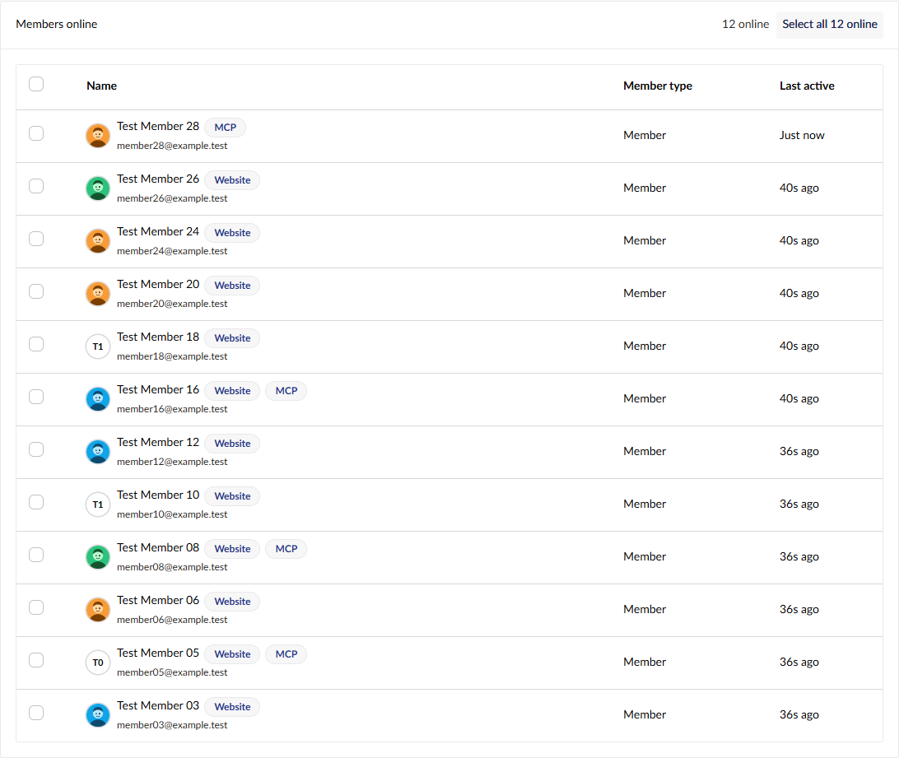

# Getting started

This guide takes you from installing Umbricians Live View to a dashboard showing your own data.

- [Requirements](#requirements)
- [1. Install the package](#1-install-the-package)
- [2. Open the dashboard](#2-open-the-dashboard)
- [Permissions](#permissions)
- [3. What you are looking at](#3-what-you-are-looking-at)
- [4. Configure what is counted](#4-configure-what-is-counted)
- [5. Add your own lines](#5-add-your-own-lines)
- [6. Message backoffice users and members](#6-message-backoffice-users-and-members)
- [Before you go live](#before-you-go-live)
- [Troubleshooting](#troubleshooting)

## Requirements

- Umbraco 17.8 or later (including Umbraco 18).
- .NET 10.

## 1. Install the package

```bash
dotnet add package Umbricians.LiveView
```

That is all the setup there is: no composer to add, no database tables, no configuration needed. The package registers
itself when the site starts.

## 2. Open the dashboard

Restart the site, sign in to the backoffice and go to **Settings → Live View**. If there are more dashboards than fit,
it is under the **…** menu at the end of the dashboard tabs.

To see it, a user needs access to the **Settings** section and the **View Live View** permission (see below). The
**Administrators** group gets every Live View permission automatically when the package is installed.

## Permissions

Live View adds three permissions to Umbraco's user groups. Find them under **Users → User groups → (a group) →
Live View**, below Umbraco's own permissions:

| Permission | What it allows |
|---|---|
| **View Live View** | See the Live View dashboard in Settings: live activity and who is online. |
| **Message backoffice users** | Select backoffice users and send them a notification. |
| **Message members** | Select website members and send them a message, once a developer has [set up a delivery method](member-messaging.md). |

- **Administrators get all three** when the package is first installed, or when a site upgrades to a version with
  permissions, so the dashboard keeps working. This happens once; any changes you make afterwards are kept.
- **Other groups get none** until you switch them on.
- **Both messaging permissions need View Live View as well**, because the buttons are on the dashboard. The dashboard
  also needs access to the Settings section, where it lives.
- **Receiving messages needs no permission.** Every backoffice user can receive notifications sent from Live View.
- **The server checks them too.** Without a permission, the matching API calls are refused (403), not just hidden.

For example, to let a support team watch the site during a release and warn editors, give their group the Settings
section, **View Live View** and **Message backoffice users**.

## 3. What you are looking at

The chart refreshes every 2, 5, 10, 15 or 30 seconds (the drop-down in the header; each browser remembers its choice)
and keeps the last 120 readings while the page is open. Nothing is stored in the database.

Click a counter above the chart, or its entry in the legend, to take that line off the chart: the line disappears and
the counter and legend entry fade. Click either of them again to bring the line back. The line keeps recording while it is
off, and every line is back on the next time you open the dashboard.

| Line | Counts | A session is |
|---|---|---|
| **Web sessions** | front-end visitors | a browser (IP address + User-Agent) seen in the last 5 minutes |
| **Members online** | visitors logged in as members | a member seen in the last 5 minutes; removed as soon as they log out |
| **Backoffice users** | editors with the backoffice open | a backoffice user with a backoffice tab open or seen in the last 5 minutes, however many tabs they have open |
| **MCP sessions** | clients of an MCP endpoint hosted by the site (`/mcp`, `/umbraco/mcp`) | an `Mcp-Session-Id`, or the caller's token or IP address |
| **API sessions** | callers of `/api` and the Delivery API | an `Api-Key` header, or the caller's token or IP address, seen in the last 60 seconds |

Below the chart, **Backoffice users online** and **Members online** list who is online right now, one row per person,
25 per page.

- **Pictures.** Backoffice users are shown with the avatar they set in Umbraco. Members are shown with their initials,
  or with a picture if you name a member image property in `MemberAvatarProperty` (see below) or plug in your own
  [avatar provider](../README.md#5-member-avatars).
- **How they are online.** Someone using an MCP endpoint the site hosts, signed in as a backoffice user or member, is
  listed in the matching table too, still on one row. While anyone in a table is on MCP, every row in it is tagged:
  **Website** or **MCP** for members, **Backoffice** or **MCP** for users, or both. Hover over a tag to see when they
  were last seen that way. While nobody is on MCP, there are no tags.
- **Users only on MCP** show "–" for open tabs and can't be selected for a message, since a backoffice message is
  shown in a backoffice tab.



Crawlers, static files (CSS, JavaScript, images and so on) and the backoffice's own requests are not counted as web
sessions.

## 4. Configure what is counted

Everything is optional. Add a `Umbricians:LiveView` section to `appsettings.json` and set only what you want to
change:

```json
{
  "Umbricians": {
    "LiveView": {
      "ActivityWindowSeconds": 300,
      "Channels": {
        "mcp": { "PathPrefixes": [ "/ai/mcp" ] },
        "api": { "Enabled": false },
        "headless": {
          "Name": "Headless app",
          "Color": "#a16207",
          "PathPrefixes": [ "/graphql" ],
          "SessionKeys": [ "Header:X-Client-Id", "Client" ]
        }
      }
    }
  }
}
```

This example moves the MCP line to a different path, turns the API line off and adds a new line for a GraphQL
endpoint, keyed on a client id header.

| Setting | Default | What it does |
|---|---|---|
| `TrackingEnabled` | `true` | Turns request counting off entirely. Custom lines from code still show. |
| `ActivityWindowSeconds` | `300` | How long a session counts as active after its last request. Each channel can override it. |
| `IgnoreBots` | `true` | Ignores requests whose User-Agent looks like a crawler. |
| `MaxSessionsPerChannel` | `100000` | A safety limit on sessions held in memory per line. |
| `MemberAvatarProperty` | none | The alias of a member image property (media picker, image cropper or upload) to show as each member's picture. For other sources, see [Member avatars](../README.md#5-member-avatars). |
| `MessageTimeZone` | the sender's own | The time zone "midnight tonight" means when messaging members, as an IANA id such as `America/Denver` (a Windows id works too). |

Each channel under `Channels` can set `Enabled`, `Name`, `Color`, `SortOrder`, `PathPrefixes`,
`ExcludePathPrefixes`, `SessionKeys` (`Header:<name>`, `Cookie:<name>`, `Authorization`, `User` or `Client`),
`ActivityWindowSeconds`, `IgnoreStaticFiles` and `Exclusive`. The built-in channels (`web`, `members`, `backoffice`,
`mcp`, `api`) keep their defaults for anything you leave out. `SessionKeys` and `Exclusive` don't apply to
`members`, which always counts the signed-in member and also counts them as a web visitor. `SessionKeys` doesn't
apply to `backoffice`, which always counts the signed-in backoffice user. See
[How sessions are counted](../README.md#how-sessions-are-counted) for the details.

## 5. Add your own lines

Anything the site can count can go on the chart. Pick the approach that fits:

- **Requests to certain paths:** add a channel in `appsettings.json`, as above. No code needed.
- **Sessions your code knows about**, such as SignalR connections: declare a channel with
  `builder.AddLiveViewChannel(...)` and call `ILiveActivityTracker.Touch` / `End` from your code.
- **Any number you can work out on demand**, such as a queue length or a count from another service: implement
  `ILiveMetricProvider` and register it with `builder.AddLiveViewMetric<T>()`.

A complete metric provider looks like this:

```csharp
using Umbraco.Cms.Core.Composing;
using Umbraco.Cms.Core.DependencyInjection;
using Umbricians.LiveView.Extensions;
using Umbricians.LiveView.Metrics;

public class PendingOrdersMetric(IOrderService orders) : ILiveMetricProvider
{
    public string Alias => "pending-orders";
    public string Name => "Pending orders";
    public string? Color => "#0ea5e9";

    public async Task<double> GetValueAsync(CancellationToken cancellationToken) =>
        await orders.CountPendingAsync(cancellationToken);
}

public class LiveViewComposer : IComposer
{
    public void Compose(IUmbracoBuilder builder) => builder.AddLiveViewMetric<PendingOrdersMetric>();
}
```

Providers are called every time the dashboard refreshes and are given 2 seconds to answer, so keep them cheap: cache
anything expensive. The [README](../README.md#extending) has examples of the other two approaches.

## 6. Message backoffice users and members

**Backoffice users** can be messaged by anyone with the **Message backoffice users** permission: tick users (or
click **Select all N online**), then **Message users…**. The message pops up in their backoffice as an Umbraco notification that stays until dismissed. You
are marked **You** in the list and can't select yourself, and "everyone online" means everyone except you.

**Members** can be messaged by anyone with the **Message members** permission, but only once you decide how
messages should reach them: a banner, a live pop-up, email or something else. See
[Messaging members](member-messaging.md).

## Before you go live

- **Behind a proxy or load balancer, forward the client IP.** Web sessions are told apart by IP address and
  User-Agent. If the site sits behind a reverse proxy, CDN or load balancer, every request appears to come from the
  proxy, and visitors with the same browser are counted as one. Configure ASP.NET Core's
  [forwarded headers](https://learn.microsoft.com/aspnet/core/host-and-deploy/proxy-load-balancer) so the real client
  IP is used.
- **Counts are per server.** Everything is held in memory, so on a load-balanced site each server shows the traffic it
  handled. The same goes for queued messages.
- **Nothing is persisted.** Restarting the site resets the counts and clears any queued messages.

## Troubleshooting

**The Live View tab is missing.** Check the user's groups have access to the **Settings** section and the
**View Live View** permission, and that the site was restarted after installing. Look under the **…** menu if the
dashboard tabs are crowded. Permission changes apply after the user reloads the backoffice.

**There are no checkboxes or Message buttons.** The user's groups need **Message backoffice users** or
**Message members**. Members can only be messaged once a developer has set up a delivery method.

**A line stays at zero.** Requests must reach the site through the paths the channel watches. For members, the
request must be a front-end page view by a logged-in member. MCP and API paths default to `/mcp`, `/umbraco/mcp`,
`/api` and `/umbraco/delivery/api`.

**Web sessions look too low.** See forwarding the client IP, above.

**The chart stops updating.** The dashboard uses your backoffice session. If you were signed out, sign in again and
the dashboard resumes.
